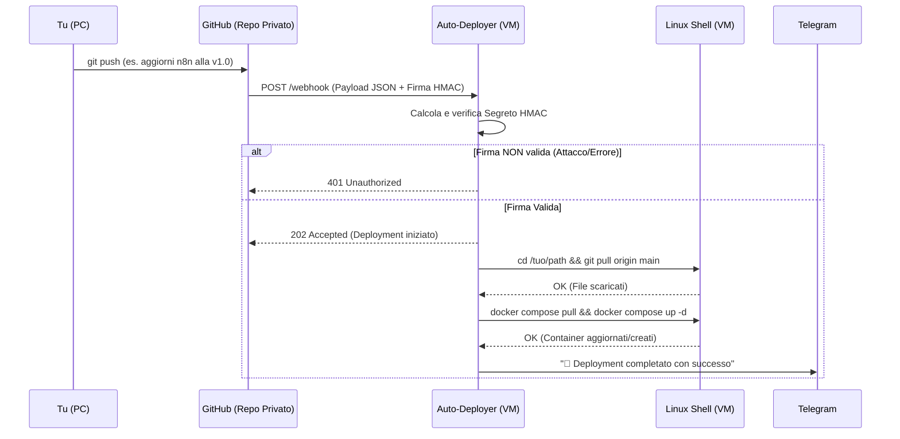

# Technical Design Document (TDD) - GitOps Auto-Deployer

## 1. Obiettivo del Progetto
Sviluppare un microservizio locale (Webhook Listener) che automatizzi il ciclo di rilascio (deployment) dei servizi self-hosted. Il tool riceve notifiche da un repository Git (es. GitHub) ogni volta che modifichi un file di configurazione, scarica in automatico le modifiche ed esegue il riavvio o l'aggiornamento dei container Docker interessati, inviandoti l'esito finale.

## 2. Architettura di Sistema

```mermaid
flowchart TD
    U[Utente / PC Locale] -->|git push| G[GitHub / GitLab Privato]
    G -->|HTTP POST (Webhook)| W[GitOps Webhook Listener\nFastAPI]
    W -->|Verifica firma crittografica HMAC| W
    W -->|1. git pull| FS[(Cartella Server\n/opt/docker)]
    W -->|2. docker compose up -d| D[Docker Daemon Socket]
    D -->|Riavvio/Aggiornamento| C[I tuoi Container (Nginx, Navidrome, ecc.)]
    W -->|Esito (Successo/Log di Errore)| N[n8n / Telegram]
```

## 3. Scelte Tecnologiche
*   **Linguaggio Backend:** Python 3.11+ con **FastAPI**. (Un'ottima alternativa sarebbe Go per via del singolo binario, ma Python ci permette di svilupparlo rapidamente mantenendo il codice iper-leggibile).
*   **Sicurezza (Cruciale):** Non vogliamo che chiunque su internet possa riavviare i nostri container. Useremo la validazione **HMAC-SHA256**. GitHub invia un *Secret* firmato negli header della richiesta (`X-Hub-Signature-256`); il nostro tool verificherà crittograficamente la firma prima di compiere qualsiasi azione.
*   **Motore di Esecuzione:** Modulo standard `subprocess` di Python per lanciare i comandi `git` e `docker` sul sistema operativo host (o tramite il montaggio del volume `/var/run/docker.sock`).
*   **Notifiche:** Webhook verso la tua istanza **n8n** o messaggi diretti tramite Bot Telegram (libreria `requests` o asincrona `httpx`).

## 4. Flusso Logico (Sequence Diagram)



## 5. Struttura del Codice (Proposta)

```text
gitops_deployer/
├── Dockerfile             # Per far girare il listener stesso in container
├── config.yaml            # Secret GitHub, Path locali, Token notifiche
├── src/
│   ├── main.py            # API FastAPI (Rotta /webhook)
│   ├── security.py        # Logica di validazione HMAC
│   ├── executor.py        # Wrapper sicuro per 'subprocess' (git e docker)
│   └── notifier.py        # Modulo invio esiti a Telegram/n8n
└── tests/
    ├── test_security.py   # Test TDD sulla crittografia
    └── test_executor.py   # Test TDD per simulare i comandi shell
```

## 6. Approccio Test-Driven Development (TDD)
Dato che questo tool interagisce pesantemente con il sistema operativo, seguiremo un approccio TDD per evitare disastri (come eseguire comandi errati sul server):

1.  **Test Sicurezza (`test_security.py`):** Scriveremo un test che inietta un header `X-Hub-Signature-256` finto e verifica che l'app risponda con errore `401`. Poi ne scriveremo uno con una firma crittografata correttamente (usando una chiave di test) per assicurarci che passi (`200/202`).
2.  **Test Esecutore (`test_executor.py`):** "Mockeremo" (simuleremo) la libreria `subprocess`. Non vogliamo che i test riavviino davvero i container sulla VM! Verificheremo semplicemente che il nostro codice Python costruisca l'array di comandi esatto (es. `["docker", "compose", "up", "-d"]`) e gestisca correttamente i codici di uscita (`exit_code == 0` per successo, `!= 0` per errore).

## 7. Precauzioni di Sicurezza (Prevenzione Command Injection)
*   Il nostro script non prenderà MAI stringhe arbitrarie inviate da GitHub per metterle nella shell. I comandi saranno rigorosamente **hard-coded** in Python in formato array.
    *   *Sbagliato (Rischio):* `os.system("docker compose up " + repo_name)`
    *   *Sicuro:* `subprocess.run(["docker", "compose", "up", "-d"], cwd="/path/sicuro")`
*   Il container del deployer avrà bisogno di accedere al file socket `/var/run/docker.sock` in sola modalità protetta, permettendogli di parlare col demone senza dargli privilegi di root assoluti sull'host.
